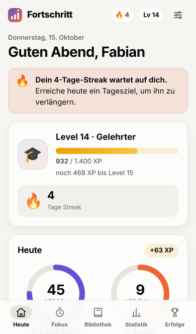
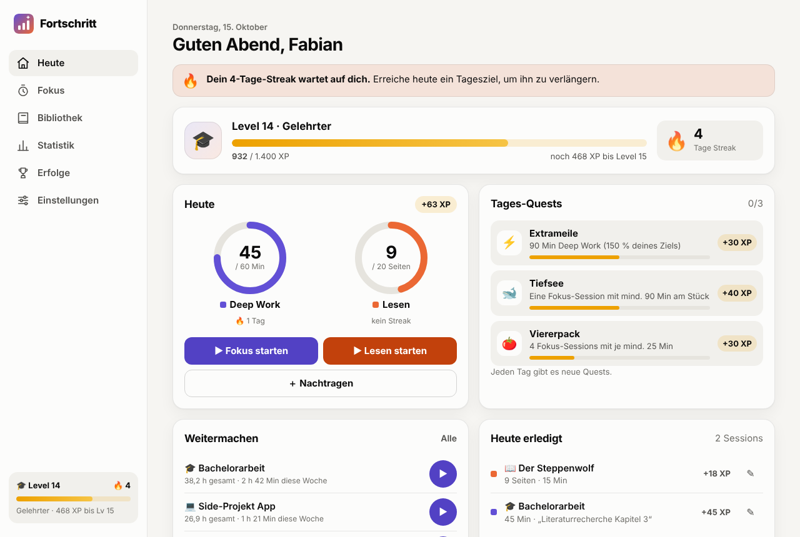

# Fortschritt 📈

Eine gamifizierte App, um **Lesen** und **Deep Work** (bzw. die Arbeit an deinen Projekten) zu tracken – damit du leichter dranbleibst.
Läuft auf **Laptop und Handy**, lässt sich wie eine normale App installieren, funktioniert offline und braucht keinen eigenen Server.

<p>
  
  
</p>

## Was die App kann

- **Fokus-Timer** für Deep Work und Lesen – frei oder mit 25 / 50 / 90 Minuten. Läuft weiter, auch wenn du die App schließt.
- **Bücher** mit Seitenzahl und Fortschrittsbalken („noch 120 Seiten – ca. 6 Tage bei deinem Ziel“).
- **Projekte** für deine Deep-Work-Zeit, optional mit Stundenziel.
- **Tagesziele** (Standard: 60 Min Deep Work, 20 Seiten) als Fortschrittsringe.
- **Statistik**: Säulendiagramme der letzten 14 Tage, Aktivitäts-Heatmap, Wochenvergleich, Zeit je Projekt, kompletter Verlauf.
- **Sync zwischen Laptop und Handy** über ein geheimes GitHub-Gist (optional).
- **Backup** als JSON exportieren / importieren. Hell- und Dunkelmodus.

## Das Spiel dahinter 🎮

| Was | Belohnung |
| --- | --- |
| 1 Minute Deep Work | 1 XP |
| 1 gelesene Seite | 2 XP (oder 1 XP pro Lese-Minute, falls mehr) |
| Tagesziel erreicht | +20 XP je Ziel, +20 XP extra für einen perfekten Tag |
| Streak 🔥 | +2 XP pro Streak-Tag (max. +30 XP/Tag) |
| Tages-Quests | 3 wechselnde Herausforderungen pro Tag, +10 bis +40 XP |
| Buch beendet | +100 XP |

- **Level & Ränge**: vom 🌱 Neuling über ⚔️ Fokus-Krieger und 🎓 Gelehrten bis zum ✨ Mythos.
- **Streak**: Ein Tag zählt, wenn du mindestens ein Tagesziel erreichst. Alle 7 Streak-Tage gibt es einen 🧊 **Joker**, der einen verpassten Tag automatisch rettet (max. 2).
- **24 Abzeichen** – von „Erster Schritt“ bis „Unaufhaltsam“ (100 Tage Streak).
- Konfetti, Level-Up-Animation und kleine Hinweise, wenn dein Streak in Gefahr ist oder du kurz vor dem Ziel stehst.

Alle XP werden aus deinen Sessions berechnet. Wenn du eine Session korrigierst oder löschst, passen sich XP, Streaks und Abzeichen automatisch an.

## Auf Laptop und Handy nutzen

### 1. Einmalig online stellen (GitHub Pages, kostenlos)

1. Im Repository auf **Settings → Pages** gehen.
2. Bei **Build and deployment → Source** „**Deploy from a branch**“ wählen.
3. Als Branch den Branch mit der App wählen (z. B. `main`) und Ordner **`/ (root)`** → **Save**.
4. Nach ca. einer Minute läuft die App unter **https://fabian9876543.github.io/Fortschritt-App/**

### 2. Als App installieren

- **iPhone / iPad (Safari):** Seite öffnen → Teilen-Symbol → „Zum Home-Bildschirm“.
- **Android (Chrome):** Seite öffnen → Menü ⋮ → „App installieren“.
- **Laptop (Chrome / Edge):** Installations-Symbol rechts in der Adressleiste. Funktioniert aber auch einfach als Lesezeichen.

### 3. Sync einrichten (damit beide Geräte denselben Stand haben)

Ohne Sync liegen die Daten nur auf dem jeweiligen Gerät. Für den Abgleich:

1. Auf GitHub einen Token erstellen: [Token mit Gist-Recht anlegen](https://github.com/settings/tokens/new?scopes=gist&description=Fortschritt-App) – nur das Häkchen bei `gist` setzen.
2. In der App unter **Einstellungen → Sync** den Token einfügen und „Verbinden“ drücken.
3. Auf dem zweiten Gerät genau dasselbe. Fertig – ab dann wird bei jeder Änderung und beim Öffnen der App automatisch abgeglichen.

Die Daten landen in einem *geheimen* Gist in deinem GitHub-Account (nicht öffentlich gelistet). Der Token bleibt auf dem Gerät und wird nur an `api.github.com` geschickt. Änderungen von beiden Geräten werden zusammengeführt – auch wenn du auf einem Gerät offline warst.

## Datenschutz

Alles wird lokal im Browser gespeichert (`localStorage`). Es gibt kein Tracking und keinen eigenen Server. Der Sync ist optional und läuft ausschließlich über dein eigenes GitHub-Gist.

## Entwicklung

Reines HTML, CSS und JavaScript (ES-Module) – kein Build-Schritt, keine Abhängigkeiten.

```bash
npm start   # lokaler Server auf http://localhost:8080 (alternativ: python3 -m http.server 8080)
npm test    # Tests für XP, Level, Streaks, Quests und Sync-Merge (Node ≥ 20)
```

```
index.html            App-Gerüst und Navigation
css/styles.css        Design (hell/dunkel, Handy/Laptop)
js/logic.js           Spiellogik: XP, Level, Streaks, Joker, Quests, Abzeichen, Merge
js/store.js           Speicherung im Browser
js/sync.js            Sync über GitHub-Gist
js/views.js           Die Seiten (Heute, Fokus, Bibliothek, Statistik, Erfolge, Einstellungen)
js/charts.js          Ringe, Säulen, Heatmap
js/ui.js              Toasts, Dialoge, Tooltips, Konfetti
js/app.js             Steuerung: Routing, Timer, Belohnungen, Sync
sw.js                 Service Worker (Offline-Modus)
tests/                Unit-Tests
```

Tipp zum Anpassen: Die Spielregeln (XP-Werte, Level-Kurve, Quests, Abzeichen) stehen gesammelt oben in `js/logic.js`.
